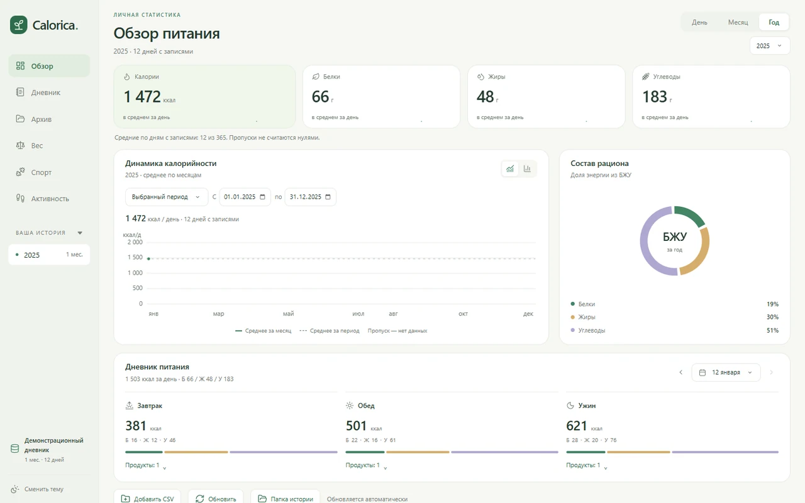

# Calorica - дневник питания и активности

Автор проекта - **Евгений Толмачев**. [Профиль GitHub](https://github.com/EvgenyET) · [Проект в портфолио](https://evgeny-dev.pro/project.html?id=Calorica)

Дневник питания и активности для Windows. Учёт калорий и БЖУ, история веса, тренировок и шагов, интерактивные графики и импорт данных с локальным сохранением.

## Задача проекта

Проект решает задачу объединения разрозненной истории питания и активности в понятную систему просмотра. При расчёте статистики учитывается наличие реальных записей за день. Пропуски и расчётные значения отображаются с учётом их происхождения, чтобы графики оставались интерпретируемыми.

## Мой вклад

Разработал оболочку Windows на C# и WebView2 и связал её с интерфейсом JavaScript. Реализовал импорт и чтение истории, локальное сохранение и восстановление состояния. Подготовил обзор питания, дневник, интерактивные графики D3 для веса и активности, расчёт показателей по дням с записями и переходы от сводки к деталям.

## Интерфейс

**Обзор питания на демонстрационных данных**

**Дневник приёмов пищи на демонстрационных данных**

## Как работает приложение

Calorica собирает питание, вес и физическую активность в одном настольном дневнике. Пользователь начинает с обзора за месяц, выбирает день и видит продукты, порции, калории и БЖУ, из которых получился итог. Разделы веса, тренировок и шагов показывают динамику за выбранный период. Приложение импортирует накопленную историю и сохраняет рабочее состояние локально, чтобы после запуска можно было вернуться к выбранному разделу.

## Возможности

- Обзор питания за месяц с калориями, белками, жирами и углеводами.
- Дневник по датам с продуктами, порциями и итогами дня.
- Графики веса с выбором периода и выделением характерных значений.
- Отдельные разделы тренировок и шагов.
- Импорт накопленной истории и локальное сохранение данных.
- Переход от обзорной статистики к записям выбранного дня.
- Восстановление состояния интерфейса и обработка повторного запуска приложения.

## Техническое устройство

### Окно Windows

Нативная оболочка запускает WebView2 и следит за повторным открытием программы. При возвращении к дневнику восстанавливается ранее выбранное состояние интерфейса.

### Дневник

Экраны питания работают с записями по датам. Мост между JavaScript и нативной частью передаёт запросы на чтение истории и сохранение изменений в локальное хранилище.

### История и графики

История питания, веса и спорта выводится в отдельных представлениях. При расчёте средних учитываются дни с записями, чтобы пропуск не превращался на графике в день с нулевым результатом.

## Технологии

| Технология | Роль в проекте |
| --- | --- |
| C# / WinForms / WebView2 | Окно Windows, запуск встроенного интерфейса и взаимодействие с локальными файлами. |
| JavaScript / D3 | Состояние дневника, расчёт показателей и интерактивные графики. |
| HTML / CSS | Компоновка обзора, дневника питания и разделов активности. |

## Демонстрация

На странице портфолио доступны описание, галерея и видеодемонстрация проекта. [Открыть Calorica - дневник питания и активности](https://evgeny-dev.pro/project.html?id=Calorica).
