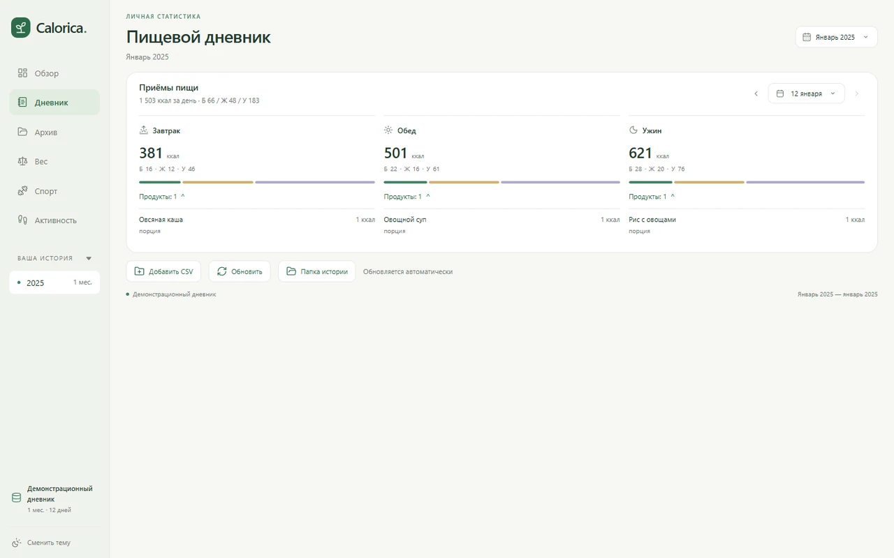

# Calorica - дневник питания и активности

**Автор проекта:** [Евгений Толмачев](https://github.com/EvgenyET) · [Страница проекта в портфолио](https://evgeny-dev.pro/project.html?id=Calorica)

Приложение для Windows объединяет питание, калории и БЖУ, вес, тренировки и шаги в одном локальном дневнике.

## Мой вклад

Разработал дневник для Windows, который объединяет питание, вес и активность. Реализовал импорт истории и локальное сохранение, связал обзорные графики с записями за конкретный день. При расчёте средних учитываю дни, за которые действительно есть записи.

## Интерфейс

**Обзор питания на демонстрационных данных**

**Дневник приёмов пищи на демонстрационных данных**

## Как это работает

По дате можно открыть приёмы пищи и состав рациона, затем посмотреть динамику за месяц или год. Для веса, спорта и шагов доступны отдельные графики и история записей.

## Возможности

- Дневник питания с продуктами, порциями, калориями и БЖУ.
- Графики веса, тренировок и шагов с выбором периода.
- Импорт истории и восстановление выбранного раздела после запуска.

## Технологии

- **C# и WebView2** - Настольное окно и связь с локальными данными.
- **JavaScript и D3** - Интерактивное представление статистики.
- **HTML и CSS** - Экраны дневника и оформление элементов управления.

## О проекте

Программа объединяет данные из разных архивов и сохраняет состояние локально. При расчёте средних приложение учитывает дни с записями. Пропуски в активности и расчётные значения веса отображаются отдельно.

Коммерческий проект. Исходный код закрыт.
